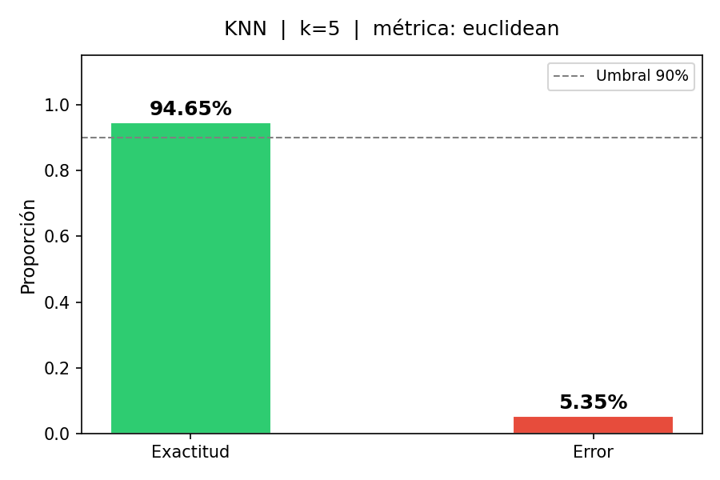
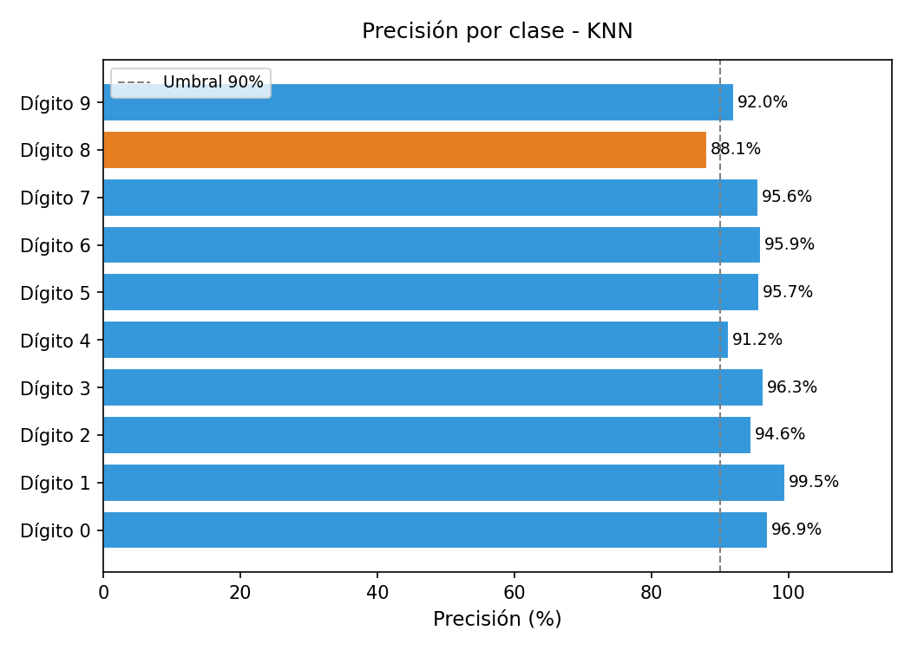
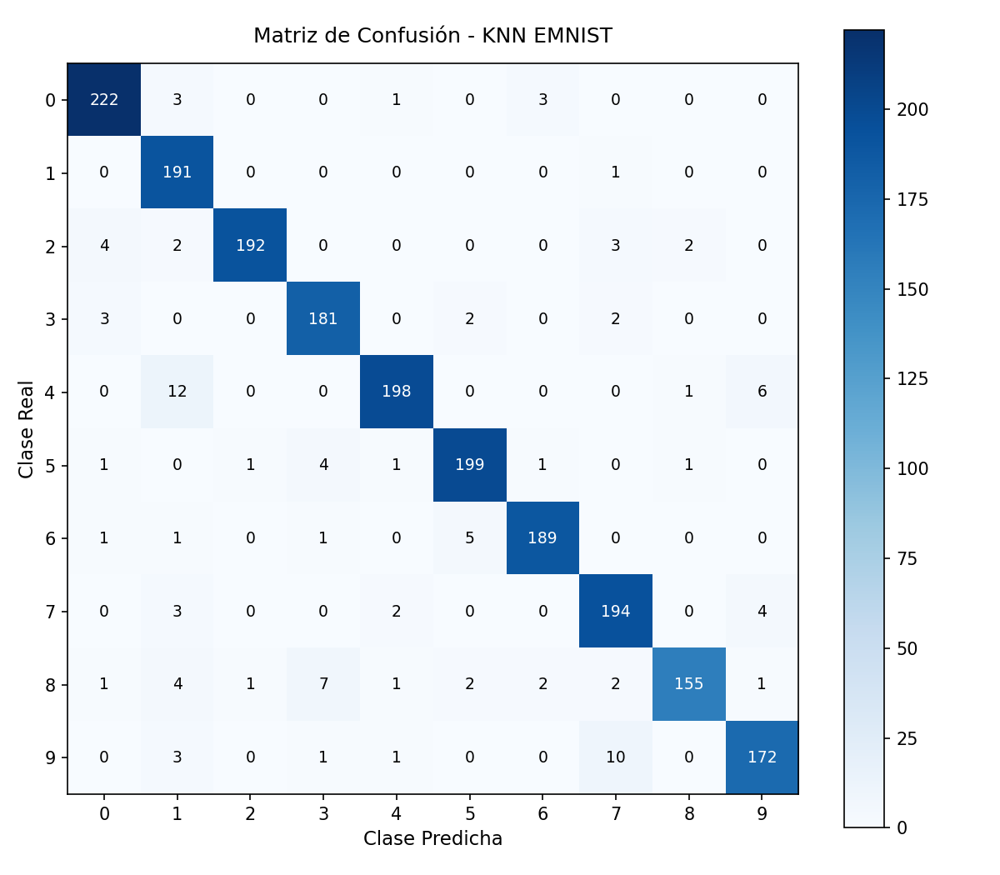

# 🧠 Clasificador K-Nearest Neighbors (KNN) para EMNIST Digits

[](https://www.python.org/)
[](https://numpy.org/)
[](https://scipy.org/)
[](https://matplotlib.org/)
[](LICENSE)

Implementación modular desde cero (*scratch implementation*) del algoritmo **K-Nearest Neighbors (KNN)** en Python para el reconocimiento y clasificación de dígitos manuscritos del conjunto de datos **EMNIST Digits**, sin recurrir a bibliotecas de alto nivel para el aprendizaje automático (como `sklearn.neighbors` o `fitKNN`).

---

## 📌 Tabla de Contenidos

1. [Descripción General](#-descripción-general)
2. [Características Destacadas](#-características-destacadas)
3. [Fundamentos Teóricos y Matemáticos](#-fundamentos-teóricos-y-matemáticos)
4. [Estructura del Proyecto](#-estructura-del-proyecto)
5. [Instalación y Requisitos](#-instalación-y-requisitos)
6. [Configuración y Variables de Entorno](#-configuración-y-variables-de-entorno)
7. [Guía de Ejecución](#-guía-de-ejecución)
8. [Resultados y Métricas](#-resultados-y-métricas)
9. [Visualizaciones](#-visualizaciones)
10. [Buenas Prácticas y Seguridad](#-buenas-prácticas-y-seguridad)

---

## 📖 Descripción General

El objetivo de este proyecto es construir un clasificador supervisado transparente, eficiente y matemáticamente riguroso aplicando el paradigma de **Lazy Learning** (aprendizaje perezoso). A diferencia de los modelos paramétricos que calculan coeficientes o pesos durante una etapa de entrenamiento explícita, KNN memoriza las instancias observadas y pospone todo el cómputo para la fase de inferencia.

El modelo se prueba sobre el benchmark **EMNIST Digits** (Extended MNIST), el cual contiene imágenes en escala de grises de $28 \times 28$ píxeles (784 características) correspondientes a dígitos del `0` al `9`.

---

## ✨ Características Destacadas

* **Implementación Scratch:** Algoritmo KNN codificado íntegramente con matrices de `NumPy` y cálculo vectorizado de distancias con `SciPy`.
* **Múltiples Métricas de Distancia:**
  * Distancia Euclidiana ($L_2$)
  * Distancia Manhattan ($L_1$)
  * Distancia Coseno
* **Estrategias de Votación Flexibles:**
  * **Voto Uniforme:** Mayoría simple entre los $k$ vecinos más cercanos.
  * **Voto Ponderado por Distancia:** Cada vecino aporta un peso inversamente proporcional a su proximidad ($w_i = \frac{1}{d_i + \epsilon}$), otorgando mayor influencia a los vecinos más cercanos.
* **Inferencia por Lotes (*Batch Processing*):** Procesa el conjunto de prueba en bloques configurables (por defecto 200 muestras) con reporte dinámico de progreso en consola, optimizando el consumo de memoria RAM y acelerando los cálculos matriciales.
* **Evaluación Completa:**
  * Cálculo de Exactitud (*Accuracy*) y Tasa de Error.
  * Matriz de confusión bidimensional generada con `NumPy`.
  * Precisión porcentual individual por dígito (0 a 9).
  * Reporte de los pares de clases más frecuentemente confundidos.
* **Visualizador Dual:**
  * **Modo Consola (ASCII Art):** Renderiza los dígitos directamente en la terminal utilizando caracteres ASCII, aplicando automáticamente la transposición requerida por el formato de almacenamiento de EMNIST.
  * **Modo Gráfico (Matplotlib):** Exportación automática de figuras de alta resolución (`exactitud_error.png`, `precision_por_clase.png`, `matriz_confusion.png`).

---

## 📐 Fundamentos Teóricos y Matemáticos

### 1. Cálculo de Distancias
Dada una muestra de prueba $\mathbf{x} \in \mathbb{R}^D$ y una muestra de entrenamiento $\mathbf{y} \in \mathbb{R}^D$ con $D = 784$:

* **Distancia Euclidiana ($L_2$):**
  $$d_{\text{Euclidiana}}(\mathbf{x}, \mathbf{y}) = \sqrt{\sum_{i=1}^{D} (x_i - y_i)^2}$$

* **Distancia Manhattan ($L_1$):**
  $$d_{\text{Manhattan}}(\mathbf{x}, \mathbf{y}) = \sum_{i=1}^{D} |x_i - y_i|$$

* **Distancia Coseno:**
  $$d_{\text{Coseno}}(\mathbf{x}, \mathbf{y}) = 1 - \frac{\mathbf{x} \cdot \mathbf{y}}{\|\mathbf{x}\|_2 \|\mathbf{y}\|_2}$$

### 2. Esquema de Votación Ponderada
Para evitar sesgos cuando los $k$ vecinos se encuentran a distancias muy dispares:
$$w_i = \frac{1}{d(\mathbf{x}, \mathbf{y}_i) + \epsilon}, \quad \text{con } \epsilon = 10^{-10}$$
$$\hat{y} = \arg\max_{c \in \{0, \dots, 9\}} \sum_{i: y_i = c} w_i$$

---

## 📁 Estructura del Proyecto

```text
├── .env.example               # Plantilla para configuración de rutas locales
├── .gitignore                  # Exclusión de archivos basura, pycache, env y datasets
├── requirements.txt            # Dependencias del proyecto
├── README.md                   # Documentación principal
├── data/                       # Carpeta local para los datasets (excluida de git)
│   └── README.md
└── knn_emnist/
    ├── __init__.py
    ├── config.py               # Hiperparámetros, variables de entorno y rutas
    ├── main.py                 # Script orquestador del pipeline completo
    ├── clasificador/
    │   ├── __init__.py
    │   ├── distancias.py       # Cálculo de distancias (vectorizado y batch)
    │   ├── votacion.py         # Selección de K vecinos y reglas de votación
    │   └── knn.py              # Clase ClasificadorKNN (ajustar y predecir)
    ├── datos/
    │   ├── __init__.py
    │   └── cargar_datos.py     # Carga de CSV y normalización a [0.0, 1.0]
    ├── evaluacion/
    │   ├── __init__.py
    │   ├── metricas.py         # Exactitud, tasa de error e informe en consola
    │   └── matriz_confusion.py # Construcción e impresión de matriz de confusión
    ├── visualizacion/
    │   ├── __init__.py
    │   ├── ver_ejemplos.py     # Renderizado ASCII de dígitos y análisis de fallos
    │   └── graficar_resultados.py # Exportación de gráficos PNG
    └── resultados/             # Gráficos generados tras la ejecución
        ├── exactitud_error.png
        ├── matriz_confusion.png
        └── precision_por_clase.png
```

---

## 💻 Instalación y Requisitos

### Requisitos Previos
* **Python 3.10** o superior.
* Git.

### 1. Clonar el Repositorio
```bash
git clone https://github.com/T1Angel4220/KNN-IA.git
cd KNN-IA
```

### 2. Crear y Activar un Entorno Virtual
En Windows (PowerShell):
```powershell
python -m venv venv
.\venv\Scripts\Activate.ps1
```

En Linux / macOS:
```bash
python3 -m venv venv
source venv/bin/activate
```

### 3. Instalar Dependencias
```bash
pip install -r requirements.txt
```

---

## ⚙️ Configuración y Variables de Entorno

Para evitar subir archivos pesados (>100MB) y proteger rutas o credenciales locales:

1. Descarga el dataset **EMNIST Digits** en formato CSV (disponible en [Kaggle EMNIST Dataset](https://www.kaggle.com/datasets/crawford/emnist)).
2. Copia la plantilla de entorno:
   ```bash
   cp .env.example .env
   ```
3. Configura en `.env` las rutas hacia tus archivos CSV locales:
   ```env
   EMNIST_TRAIN_PATH=data/emnist-digits-train.csv
   EMNIST_TEST_PATH=data/emnist-digits-test.csv
   ```
   *(También puedes colocarlos directamente dentro de la carpeta `data/` del proyecto).*

### Hiperparámetros en `config.py`:
* `K_VECINOS`: Número de vecinos $k$ (por defecto: `5`).
* `METRICA`: Métrica de distancia (`'euclidean'`, `'manhattan'`, `'cosine'`).
* `PESO_VECINOS`: Ponderación de voto (`'uniforme'` o `'distancia'`).
* `MAX_TRAIN`: Muestras de entrenamiento a utilizar (ej. `10000`).
* `MAX_TEST`: Muestras de prueba a evaluar (ej. `2000`).
* `BATCH_PREDICCION`: Tamaño de lote para la inferencia vectorizada (ej. `200`).

---

## 🚀 Guía de Ejecución

Ejecuta el pipeline completo desde la raíz del proyecto:

```bash
python knn_emnist/main.py
```

### Flujo de Ejecución en Consola
1. **Carga y normalización:** Carga los datos y escala los píxeles a $[0.0, 1.0]$.
2. **Ajuste (Fit):** Memoriza las muestras de entrenamiento (`Lazy Learning`).
3. **Inferencia en Lotes:** Barra de progreso dinámica en tiempo real.
4. **Métricas Globales:** Exactitud y porcentaje de error.
5. **Matriz de Confusión:** Desglose por fila/columna con precisión por clase y top de confusiones.
6. **Inspección ASCII:** Muestra dígitos clasificados y ejemplos de error en terminal.
7. **Exportación Gráfica:** Guarda figuras estadísticas en `knn_emnist/resultados/`.

---

## 📊 Resultados y Métricas

Evaluando con $k=5$, métrica Euclidiana, 10,000 muestras de entrenamiento y 2,000 muestras de prueba:

| Métrica | Valor Obtenido |
| :--- | :---: |
| **Exactitud Global (Accuracy)** | **94.65%** |
| **Tasa de Error Global** | **5.35%** |
| **Muestras Correctas** | **1,893 / 2,000** |
| **Tiempo de Inferencia / Lote** | Vectorizado en lotes de 200 con `cdist` |
| **Diagnóstico del Clasificador** | **ADECUADO** (Exactitud $\ge 90\%$) |

### Confusiones Más Frecuentes
Por la naturaleza manuscrita del dataset EMNIST, los errores más comunes corresponden a grafías ambiguas:
1. **Dígito 4 predicho como 1** (12 ocurrencias) — trazos verticales cerrados.
2. **Dígito 9 predicho como 7** (10 ocurrencias) — similitud en el bucle superior y mástil.
3. **Dígito 8 predicho como 3** (7 ocurrencias) — trazo incompleto en la curva izquierda.
4. **Dígito 4 predicho como 9** (6 ocurrencias) — unión del asta superior.
5. **Dígito 6 predicho como 5** (5 ocurrencias) — cierre parcial de la curvatura inferior.

---

## 📈 Visualizaciones

Los gráficos generados automáticamente se almacenan en `knn_emnist/resultados/`:

| Exactitud vs Error | Precisión por Clase |
| :---: | :---: |
|  |  |

| Matriz de Confusión |
| :---: |
|  |

### Ejemplo de Renderizado en Terminal (ASCII Art)
```text
  Real: 7 | Pred: 7 [OK]
  +----------------------------+
  |                            |
  |      #################     |
  |                   ####     |
  |                  ####      |
  |                #####       |
  |               ####         |
  |              ####          |
  |             ####           |
  |            ####            |
  |           ####             |
  +----------------------------+
```
